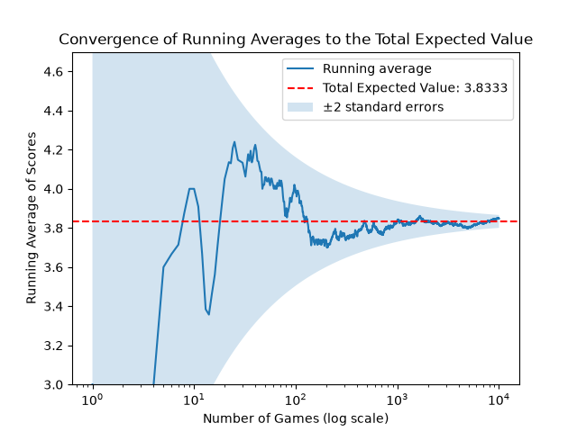

# Dice Monte Carlo Simulation

A Python simulation of a two-roll dice game, checked against the exact expected value, with a standard error band.

## The game
This is a game with at most two rolls. You are given a fair die with a whole number of sides, a threshold, and a penalty. Roll the die once. If the result is greater than or equal to the threshold, that roll is your score. If it is less than the threshold, roll again, subtract the penalty from the second roll, and that becomes your score.

## Settings used
- Number of sides: 6
- Penalty: 1.0
- Threshold: 2.5
- Number of games: 10,000

With these settings, a first roll of 3, 4, 5 or 6 is kept, and a first roll of 1 or 2 is rolled again.

## The question
I wanted to test the law of large numbers for myself. It states that as the number of independent trials of a random experiment increases, the average of the observed results approaches the expected value. I also wanted to see how the standard error describes the spread of those averages around the expected value.

## How the code is organized
- `play_single_game`: plays one game and returns its score.
- `run_monte_carlo`: plays many games and returns the running average after each one.
- `expected_value`: calculates the exact expected value of one game.
- `std_dev`: calculates the exact standard deviation of one game.

## Results
**Exact values (the same every run):**
- Expected value: 3.8333
- Standard deviation of one game: 1.64
- Standard error at 10,000 games: 0.0164

**Simulated values (these change every run, because I did not set a random seed):**
- The simulated average after 10,000 games
- The gap between the simulated average and the expected value
- That gap measured in standard errors

In about 95% of runs, the gap is within two standard errors (about 0.033), so the simulated average lands between roughly 3.80 and 3.87.

## The plot

- **Solid line:** the running average of the scores after each game, plotted against the number of games.
- **Dashed red line:** the exact expected value of the game, 3.8333.
- **Shaded band:** the expected value plus and minus two standard errors. It is wide at the start and narrows as the number of games grows, because the standard error shrinks with the square root of the number of games. At each game count, about 95% of averages should fall inside the band.

The running average wanders at first and settles close to the dashed line as more games are played, which is what the law of large numbers predicts. The x-axis uses a log scale so the early games are visible, and the vertical axis is zoomed in, so the first few games, which are far from the expected value, are cut off.

## What I learned
- **Plotting in Python.** I learned how to plot graphs with matplotlib, including a running average, a reference line and a shaded band.
- **Standard deviation vs. standard error.** The standard deviation describes how much single game scores vary around the expected value. The standard error describes how much the average of n games varies from one independent batch of games to the next. It equals the standard deviation divided by the square root of n, so averages of more games are more consistent.
- **Interest in C++.** In quantitative finance, speed matters, and this project made me want to learn C++ so I can run simulations like this one faster.

## How to run it
- You need Python 3. The `random` and `math` modules come with Python.
- You need the `matplotlib` library for the graph. On your own computer, install it with `pip install matplotlib`. It comes pre-installed in Google Colab.
- The code is in `dice_monte_carlo_convergence.py`. You can run it in Google Colab, or save it as a `.py` file and run it with Python.
- Because I did not set a random seed, the simulated numbers change slightly each time you run it.

## Next steps
- Learn how to find the best threshold and code it.
